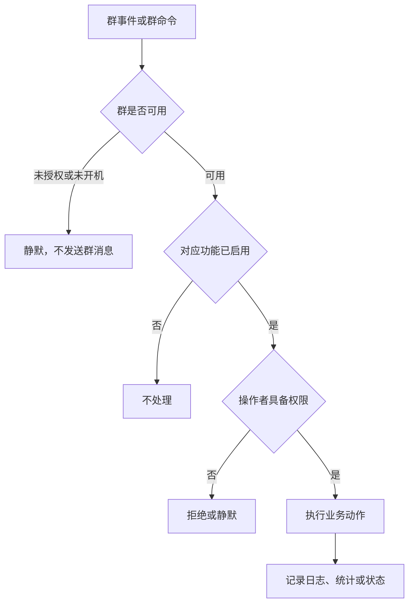
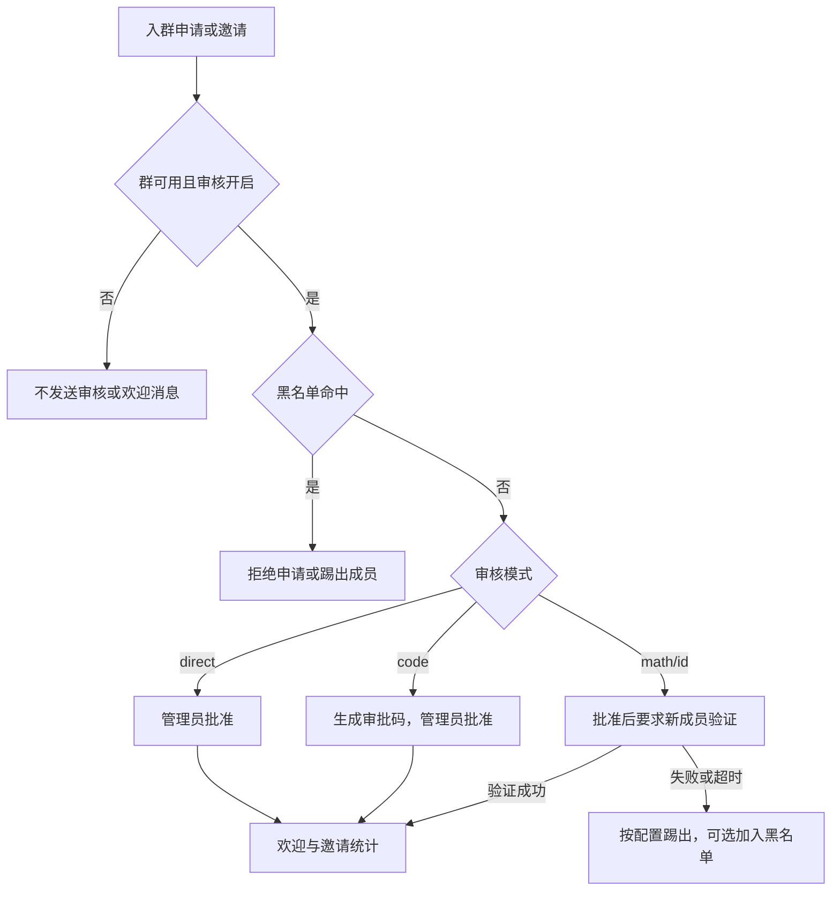

# Joker 功能使用逻辑与运营策划

**版本：** 基于当前 `v1.5.2` 代码与配置结构

**定位：** 本文不是新增功能清单，而是将已有能力组织成可执行的使用、配置和治理方案。命令可达性以代码注册与实际路由为准，`README.md` 仅作待同步的使用参考；本文定义功能之间的先后关系、使用边界和验收标准。

## 0. 代码核查结论与策划前提

本策划以当前实现为基线，而不是以帮助文本或配置项名称为基线。代码中已有的模块不等同于其每个宣传命令、每个配置项都已可稳定使用；本章明确当前行为和后续编排时不能忽略的差异。

### 0.1 授权、开机与发送门禁现状

| 控制点 | 当前实现 | 策划要求 |
| --- | --- | --- |
| 群消息最终发送 | `qqadmin/send_guard.py` 的 `can_send_group_message()` 要求 `features.power_status == "on"`；配置读取失败时拒绝发送 | 保持“默认拒绝”，所有新发送入口必须复用此函数或等价的统一服务 |
| 授权判断 | 仅当 `auth.enable_auth=true` 时检查 `is_group_authorized()`；该开关默认值为 `false` | 生产群若要求“未授权绝不发言”，必须启用严格授权策略，不能把关闭授权系统当作普通运行模式 |
| 常规群命令 | `handle_message()` 对非授权命令执行授权门禁，对非开关机命令执行开机门禁，并用 `stop_event()` 阻断后续处理 | 将此判断前置为确定的事件预处理器；不能依赖多个装饰器的注册顺序 |
| 框架回复和直接发送 | `_yield_plain()`、`_yield_chain()`、`_send_plain()`、`_send_chain()`、`_send_group_msg()`、`_send_group_msg_with_id()` 与 `qqadmin/api_client.py` 已接入群消息门禁 | 继续保留“发送瞬间复检”，延迟欢迎、定时任务和重试任务不得只在创建时检查 |
| 后台与通知事件 | 授权到期提醒、定时文本消息、入群/邀请处理、验证回复等主要路径已在发送封装或入口处检查群状态 | 为每一类后台任务建立独立测试，验证关机、失授权、禁用模块发生在等待期间时仍不发送 |
| OneBot 管理动作 | 踢人、禁言、审批、撤回等 `call_action()` 并不统一走消息门禁 | 定义单独的“动作门禁”；若关机/失授权表示完全停用，动作也必须在调用 OneBot 前复检 |

严格策略需要明确两类例外的行为，而不能只靠注释约定：

1. `激活卡密` 和开机命令可以在不可用群中执行“状态写入”，但在状态仍不可用时不得产生群回复；只有授权与开机状态写入成功后，才允许返回成功消息。
2. 白名单和主人豁免是否绕过授权必须是显式部署策略。若“没有授权”包含主人和白名单群，则应移除该豁免；若保留，则在状态页中清楚显示“豁免放行”。
3. 本文默认约束群消息。私聊发送不经过群运行状态；若“任何消息”也包含私聊，应将私聊纳入相同策略，或仅保留主人运维通道并记录审计日志。

当前 `_auth_commands` 的旁路集合没有包含实际的 `激活卡密` 命令；因此未授权群的激活流程仍存在路由顺序依赖。这是 P0 必修项，不应仅靠发送封装兜底。

### 0.2 现有功能的可用性边界

| 功能域 | 当前可确认的行为 | 策划处理方式 |
| --- | --- | --- |
| SCUM 查询与绑定 | 绑定、解绑、查询、在线查询和查询方式均有入口；`allow_other_query` 等部分配置仅被读取，未参与实际决策 | 将“已生效配置”和“保留配置”分栏展示，未接入的项不写入运营流程 |
| 欢迎与退群 | 真实可触发的是 OneBot 入群/邀请通知后的欢迎；轮询自动欢迎、关键词欢迎和部分退群流程尚未完整接入，且欢迎命令当前可能先检查“已启用”再允许开启 | 拆成“事件欢迎”“关键词回复”“成员轮询”三个独立模块；当前模板只启用事件欢迎，并保证配置命令在模块关闭时仍可用 |
| 入群审核 | 申请、邀请、入群后验证和审批码均有实现，但命令路由、`direct` 模式含义、审批权限与重复事件处理存在分叉 | 在 P2 先定义状态机，再承诺四种模式；审批类操作统一校验管理员/群主并记录外部 API 结果 |
| 定时任务 | 定时文本、全体禁言和全体解禁都有存储与循环；普通“添加定时消息”将 Cron 字段无空格拼接，导致校验失败 | 修正 Cron 解析和唯一 ID 前，不将定时文本消息列为可用运营能力；高影响定时动作需二次门禁 |
| 分群管理员 | 数据层保存管理员对象和权限列表，但角色判定以对象字符串比较，且权限列表未被全部模块采用 | 在角色链路修复前，运营上只授予插件主人、群主和 QQ 管理员真实管理权 |
| 功能权限 | `_check_feature_permission_async()` 已具备按模块权限检查的能力，但多数模块仍直接检查“管理员/群主” | 统一接入该权限服务，并将“使用、查看、配置、惩罚”拆为可审计权限 |
| 帮助与命令 | README、内置帮助、装饰器命令和手写 `GROUP_MESSAGE` 路由存在不一致；审核设置、禁言/踢出开关等若干文案没有可达入口 | 建立单一命令注册表，由注册表生成帮助和 README；未可达命令不得出现在管理员操作手册 |
| 配置同步 | 全局克隆会重建 `features`，现有开机状态可能丢失；自动同步还可能使用未重新加载的 `self.config` | 将配置、运行状态和业务数据分层；同步只覆盖规则层，必须保留开机、授权、待审、统计、黑名单和定时任务 |

### 0.3 立即纳入实施范围的缺口

以下问题不是新增功能需求，而是现有能力要进入正式运营前必须收敛的实现差异：

1. 合并分群配置来源。当前存在 `features.<feature>`、配置根字段以及授权模块独立 settings 的并行写入；例如黑名单自动动作相关设置可能写入后不影响运行时读取。
2. 让全局同步和克隆保留 `features.power_status`，并在读取最新配置后再同步，避免已开机群因同步变为静默。
3. 修复命令可达性：审核超时/次数/类型设置、普通定时消息、欢迎自动跟踪，以及帮助中声明的禁言和踢出配置命令。
4. 将审批、踢人、禁言、撤回、全体禁言/解禁等外部动作纳入统一状态门禁；消息被拦截不代表动作无影响。
5. 修复审批码同意操作的管理员校验、分群管理员对象匹配，以及自定义回复宽泛“删除”前缀与其他删除命令的冲突。
6. 以命令、事件、定时器和 OneBot 动作四类入口建立回归清单。只有通过该清单的模块才能在下文的群模板中标为“可启用”。

### 0.4 审核流程的上线约束

审核模块必须先收敛为一个可幂等的状态机，再启用自动处置。推荐状态为 `received -> pending_admin | pending_verification -> approved | rejected | expired`，请求唯一键使用群号与 OneBot 请求标识组合。

| 模式 | 目标语义 | 禁止行为 |
| --- | --- | --- |
| `direct` | 申请进入 `pending_admin`，仅管理员批准后调用 QQ 审批 API | 将直接审批错误地转为数学验证，或只改本地状态不调用外部 API |
| `code` | 审批码是管理员处理令牌，不是申请人自助通过凭据 | 普通成员用“同意 + 审批码”批准入群 |
| `math` | 成员入群后进入验证队列，答对完成验证；失败或超时按规则移出 | 在验证提示、错误提示或日志中泄露正确答案 |
| `id` | 改名为“口令验证”或明确其真实校验含义 | 让用户误以为是在校验 QQ 身份信息 |

每次审批、踢人、禁言、撤回都应按“状态复检 -> 权限复检 -> 标记处理中 -> 调 OneBot -> 写入最终状态和结果”执行。关机或失授权期间，审核超时任务只保留待处理数据，不应继续踢人或发送通知。

## 1. 目标与范围

Joker 同时承担两类职责：

1. 为 SCUM 社区提供服务器绑定、查询和轻量运营信息。
2. 为 QQ 群提供入群、内容、成员和配置管理能力。

本策划的目标是让一个新群能够按固定顺序完成启用，并让群主、管理员和普通成员清楚知道每项功能何时生效、由谁操作、会产生什么自动行为。

本期只编排现有能力：授权、开关机、分群配置、SCUM 查询、入群审核、欢迎、邀请统计、黑名单、禁言、踢出、撤回、关键词过滤、自定义回复、专属回复、定时任务、操作日志、文转图和分群管理员。不把未实现的后台、Web 面板或新外部服务作为前提。

## 2. 产品使用模型

### 2.1 三层控制面

所有群内能力按以下顺序判断：

这里的“群是否可用”由三个独立状态组成：

| 状态 | 来源 | 作用 |
| --- | --- | --- |
| 授权状态 | `auth/manager.py` 的授权记录 | 决定群是否可使用受授权限制的能力 |
| 开机状态 | 分群 `features.power_status` | 决定群是否对外工作和发送消息 |
| 功能状态 | 分群 `features.<feature>.enabled` | 决定具体模块是否运行 |

规划原则：授权、开机、功能开关、权限校验必须是叠加关系，不能相互替代。一个群即使已授权，也应当显式开机；一个群即使开机，也只有启用的模块可以运行。

### 2.2 角色模型

| 角色 | 主要职责 | 推荐使用范围 |
| --- | --- | --- |
| 插件主人 | 全局配置、授权卡密、全局黑名单、跨群管理 | 仅少数运维账号 |
| 群主/群管理员 | 本群审核、成员治理、规则和内容配置 | 日常运营主体 |
| 分群管理员 | 被委派的有限群管操作 | 只授予明确的模块权限 |
| 普通成员 | 查询、验证、查看公开统计、触发已允许的回复 | 不可修改规则或执行惩罚 |
| 入群申请者/新成员 | 完成验证、接收欢迎、形成邀请记录 | 仅参与入群流程 |

配置结构为群管模块预留了 `use_permission` 与 `modify_permission`，但当前只有部分入口实际使用该校验。策划上应将“查看/使用”和“修改/惩罚”分开并统一接入：例如邀请统计可允许成员查看，审核、踢出、黑名单和全局配置默认只允许管理员或主人修改。

## 3. 功能地图

| 场景 | 已有能力 | 主要操作者 | 启用前提 | 结果 |
| --- | --- | --- | --- | --- |
| 服务查询 | 绑定、解绑、关键词查询、在线查询 | 成员查询；管理员绑定 | SCUM 查询与绑定开关；查询命令可按群设置 | 通过 Linux 中转取得服务器信息 |
| 商业授权 | 生成卡密、激活卡密、授权查看、到期提醒 | 主人生成；群管理员激活 | 授权系统与密钥 | 建立或延长群授权记录 |
| 群工作状态 | 开机、关机 | 管理员/群主 | 群已具备管理权限 | 控制群内自动处理和对外消息 |
| 分群配置 | 克隆全局、克隆配置、启用/禁用功能、设置功能 | 管理员/群主 | 分群配置模块 | 为本群建立独立规则 |
| 入群治理 | `direct`、`code`、`math`、`id` 审核模式 | 管理员处理；新人验证 | 审核模块 | 批准、拒绝、超时清理或踢出 |
| 成员生命周期 | 入群欢迎、退群通知、邀请统计 | 自动；管理员配置 | 欢迎/统计模块 | 形成欢迎、离群和邀请记录 |
| 内容治理 | 关键词过滤、撤回规则、敏感词检测 | 自动；管理员配置 | 过滤或撤回模块 | 警告、撤回、禁言、踢出或拉黑 |
| 人员治理 | 禁言、解除禁言、踢出、连带踢出、黑名单 | 管理员/群主 | 相应模块 | 对成员执行可审计的惩罚动作 |
| 社区互动 | 自定义回复、模糊回复、专属回复 | 管理员配置；成员触发 | 回复模块 | 在满足冷却和匹配规则时回复 |
| 运营触达 | 定时消息、定时全体禁言/解禁、到期提醒 | 管理员配置；系统执行 | 定时消息或授权提醒 | 在规定时间执行任务 |
| 运营复盘 | 邀请统计、操作日志、操作统计、群统计 | 成员查看或管理员查看 | 统计/日志模块 | 评估治理和增长效果 |
| 表达优化 | 文转图、图转文 | 管理员配置 | 文转图模块及依赖 | 调整机器人输出形式 |

## 4. 推荐使用链路

### 4.1 新群启用链路

新群不应直接逐个开启自动功能。推荐执行以下顺序：

1. 插件主人在全局配置中设置主人账号、授权策略、群管总开关及各模块默认值。
2. 如启用授权系统，主人生成卡密，或直接为指定群授权。群管理员使用“激活卡密”完成本群授权。
3. 管理员确认本群已处于开机状态。卡密激活路径会自动开机；使用直接授权或克隆配置后，应显式执行“开机”。
4. 管理员使用“克隆全局”或“同步配置”创建本群基础配置，再按本群规则调整模块开关。
5. 先启用低风险、已验证可观测的模块：SCUM 查询、邀请统计和操作日志；欢迎功能待 P1 配置入口与数据源收敛后再启用。
6. P0 状态门禁和 P2 审核流程验收通过后，再启用治理模块：审核、关键词过滤、撤回、禁言、黑名单、踢出。
7. 最后配置定时任务和自动化动作；在 Cron 与动作门禁修复前，仅记录配置和进行人工演练，不在正式群启用自动惩罚。

**完成标准：** 管理员能查询当前授权、开机状态和功能状态；普通成员能使用预期查询功能；未授权或关机状态下群内没有 Joker 发出的消息。

### 4.2 SCUM 社区日常链路

1. 管理员使用“绑定id”将 SCUM 服务器绑定到本群。
2. 成员通过“查询”“查询在线”获取服务器状态；允许查询其他服务器时，可使用带关键词的查询。
3. 管理员根据群定位设置查询权限模式：仅查询或完整访问。
4. 需要减少文字刷屏时，管理员开启文转图；应先确认图片依赖与群内可读性。

**运营原则：** 查询是成员的低风险自助能力，不应与授权管理、审核或群处罚混在同一帮助入口中。

### 4.3 入群审核与欢迎链路

入群治理按“先准入、再欢迎、后统计”执行：

推荐配置策略：

| 群类型 | 审核模式 | 欢迎策略 | 推荐补充规则 |
| --- | --- | --- | --- |
| 小型熟人群 | `direct` 或 `code` | 简短欢迎 | 仅记录邀请统计 |
| 开放游戏群 | `math` 或 `id` | 验证成功后欢迎 | 设置超时和失败次数 |
| 高风险公开群 | `code` | 管理员审批后欢迎 | 启用黑名单和关键词过滤 |

审核码审批必须只由群主/管理员执行。审批、拒绝、验证成功、验证失败和超时都应写入操作日志，便于处理争议。

### 4.4 内容与成员治理链路

内容治理存在两套相近能力，应明确分工：

| 模块 | 适用对象 | 推荐用途 | 不建议的用途 |
| --- | --- | --- | --- |
| 关键词过滤 | 实时规则命中 | 广告、引流、群规违禁词；可选择警告/禁言/踢出/拉黑 | 复杂历史消息清理 |
| 撤回系统 | 已发送消息的撤回策略 | 关键词、正则、敏感内容、管理员手工撤回 | 作为唯一的成员惩罚机制 |
| 黑名单 | 身份级限制 | 重复违规者、明确风险账号、全局风险账号 | 一般性临时争议 |
| 禁言 | 可恢复的临时处罚 | 初犯、短期刷屏、冷静期 | 永久性封禁 |
| 踢出 | 当前群成员移除 | 严重违规或审核失败 | 代替黑名单的长期限制 |

推荐处罚阶梯：

1. 首次命中：警告或短时禁言。
2. 重复命中：撤回加更长禁言。
3. 严重或多次违规：踢出。
4. 明确恶意、验证失败或多次踢出：加入本群黑名单；跨群风险才使用全局黑名单。

此策略要求过滤、撤回和黑名单的动作不重复触发同一惩罚。启用 `blacklist` 动作前，应确认是否已经由审核失败自动拉黑，避免同一事件多次写日志、发送通知或重复踢出。

### 4.5 社区互动与运营触达链路

| 功能 | 使用建议 | 约束 |
| --- | --- | --- |
| 自定义回复 | 固定问答、群规入口、服务器常见问题 | 配置冷却；避免与命令前缀冲突 |
| 模糊回复 | 常见自然语言触发 | 关键词需小而准，避免误触发 |
| 专属回复 | 会员、活动获奖者、角色扮演 | 默认艾特可关闭，避免刷屏 |
| 欢迎关键词自动回复 | 仅用于低频欢迎词 | 与入群自动欢迎分开配置 |
| 定时消息 | 服务器维护提醒、活动预告、每日公告 | 先测试一次，再长期启用 |
| 定时全体禁言/解禁 | 活动开始、结束或维护窗口 | 必须配对创建，避免长期误禁言 |
| 授权到期提醒 | 仅提醒群主或指定管理员 | 不应在未开机或未授权群发送 |

## 5. 配置与数据治理

### 5.1 配置层级

| 层级 | 内容 | 变更者 | 使用原则 |
| --- | --- | --- | --- |
| 全局配置 | 模块默认值、权限默认值、授权策略、主人名单 | 插件主人 | 作为新群和同步的模板 |
| 分群配置 | 功能开关、规则、欢迎语、冷却、权限覆盖 | 群主/管理员 | 只影响当前群 |
| 运行状态 | 授权记录、开机状态、待审核、定时任务、统计、日志 | 系统与授权操作 | 不应被普通配置同步覆盖 |

`clone_global_config_to_group()` 的语义应当是“同步默认规则”，而不是“重置群运行状态”。规划要求在克隆或自动同步时保留至少以下数据：

- `features.power_status`
- 授权和到期信息
- 黑名单、禁言、审核队列、邀请统计、操作日志等业务数据
- 已创建的定时任务及其执行记录

### 5.2 可用性状态约定

| 授权 | 开机 | 功能开关 | 预期行为 |
| --- | --- | --- | --- |
| 否 | 任意 | 任意 | 不处理群业务、不发送群消息；只保留必要的授权操作入口 |
| 是 | 否 | 任意 | 不发送群消息、不执行自动审核/欢迎/定时治理；仅保留开机与必要状态查询 |
| 是 | 是 | 否 | 模块不运行，不产生模块消息或动作 |
| 是 | 是 | 是 | 按权限和规则执行 |

如果产品策略允许关闭授权系统，则必须在配置说明中明确“关闭授权系统后是否仍需要授权记录”。当前逻辑存在该语义分歧，实施前应固定为一种规则并在所有发送和动作入口中统一执行。

## 6. 命令与帮助信息策划

现有命令数量较多，帮助页不应平铺展示。建议沿用现有命令，按任务入口组织帮助内容：

| 帮助入口 | 应展示的内容 | 主要用户 |
| --- | --- | --- |
| 基础使用 | SCUM 查询、服务器绑定、授权状态、当前群状态 | 所有成员 |
| 新群启用 | 激活卡密、开机、克隆全局、启用功能、查看功能状态 | 群主/管理员 |
| 入群管理 | 审核模式、待审核列表、同意/拒绝、验证设置 | 管理员 |
| 日常治理 | 禁言、踢出、黑名单、撤回、关键词过滤 | 管理员 |
| 社区运营 | 欢迎、邀请统计、回复、定时消息、文转图 | 管理员/运营 |
| 全局运维 | 卡密、授权群列表、全局黑名单、全局配置 | 插件主人 |

帮助文本应在每个模块顶部显示四项状态：群是否授权、是否开机、该模块是否启用、当前操作者是否有权限。这样比“命令未响应”更容易定位问题，但在明确要求静默的未授权/关机状态下，不应发送任何群消息。

## 7. 实施优先级

### P0：统一可用性与安全边界

1. 将授权、开机、模块开关和权限校验收敛为可复用的群可用性判定。
2. 对发送群消息、入群审批、踢人、禁言、撤回、定时任务和延迟任务使用同一判定，并在外部 OneBot 动作前重新校验。
3. 固定授权开关语义：若要求“无授权即静默”，不能因为 `enable_auth=false` 放行未授权群。
4. 审批码同意、拒绝等管理动作必须校验管理员/群主身份。
5. 全局同步必须保留开机状态和运行数据，防止已启用群在配置更新后意外静默。

**验收：** 授权/开机/功能开关的 8 种组合均有可重复的自动化测试；未授权或关机群不存在任何 Joker 群消息、审核通知、欢迎、定时消息或到期提醒。

### P1：新群启用与状态可见性

1. 将“授权 -> 开机 -> 克隆配置 -> 启用模块”的顺序写入帮助和 README。
2. 将现有授权、开机和功能状态聚合到一个只读状态视图，避免管理员逐项猜测。
3. 明确直接授权与卡密激活的开机差异：直接授权后是否自动开机必须统一。
4. 将分群配置同步的影响范围写入命令反馈和操作日志。

**验收：** 新管理员不查代码即可在一次操作会话内完成群启用；每一步都有可核验状态。

### P2：审核与治理流程收敛

1. 固化四种审核模式的适用场景和默认值。
2. 明确黑名单、关键词过滤、撤回、禁言和踢出的优先级与去重规则。
3. 为失败、超时、自动拉黑、自动踢出和管理员手工操作补充一致的日志字段。
4. 延迟欢迎、验证超时和定时任务在执行前重新读取状态；发送失败不得写入“已发送”历史。

**验收：** 同一成员事件不会被重复处罚；日志能还原操作者、规则、目标、时间和外部 API 结果。

### P3：运营能力标准化

1. 将欢迎、专属回复、定时消息和邀请统计组成“社区运营”模板。
2. 为三类群提供可复制的分群配置：熟人群、开放游戏群、高风险公开群。
3. 通过现有操作日志和邀请统计形成周度复盘流程：增长、审核通过率、处罚类型、自动任务执行情况。

**验收：** 管理员可用克隆配置快速复制模板，同时不覆盖目标群的开机状态和业务数据。

## 8. 测试与验收矩阵

| 测试域 | 必测场景 |
| --- | --- |
| 可用性门禁 | 授权系统开启且未授权、已授权但关机、已授权且开机、严格授权部署下关闭授权开关、主人/白名单豁免；每种状态覆盖普通回复、欢迎、审核、定时、到期提醒、直接 OneBot 发送 |
| OneBot 动作门禁 | 失授权、关机、禁用模块发生在审批、踢人、禁言、撤回和全体禁言/解禁之前；确认外部动作未发生且不写入成功日志 |
| 权限 | 主人、群主、管理员、分群管理员、成员分别尝试查询、配置、审批和惩罚 |
| 入群审核 | 四种模式、管理员邀请豁免、黑名单、成功、失败、超时、重复事件 |
| 内容治理 | 关键词、正则、敏感词、管理员豁免、撤回失败、禁言/踢出/拉黑动作 |
| 配置同步 | 全局修改后同步；确认开机状态、授权、定时任务、黑名单和统计保持正确 |
| 定时与延迟 | 执行前关机、取消授权、禁用模块、修改欢迎延迟、发送失败重试或记录 |
| SCUM 查询 | 未绑定、已绑定、查询其他服务器、权限模式、文本与文转图输出 |
| 命令与文档 | 每个注册命令都能从帮助和 README 找到；每条文档命令均有可达路由、正确前缀、参数校验和权限说明 |

## 9. 风险与边界

- OneBot 动作与消息发送要分开治理。即使消息被门禁拦截，踢人、批准、撤回等外部动作仍可能造成影响。
- 流式框架结果可能绕过普通结果装饰钩子；若未来引入流式回复，必须在更早的事件阶段执行群可用性校验。
- 卡密激活、授权延长和配置同步属于写入事务，需保证失败不留下“已开机但未授权”或“已记录但未发送”的不一致状态。
- 自动化模块应默认保守：首次启用先观察，不直接启用踢出、拉黑、全体禁言等高影响动作。

## 10. 交付物

本策划落地后，文档和实现应形成以下分工：

| 文件/产物 | 责任 |
| --- | --- |
| `README.md` | 命令参考、安装和快速开始 |
| `FUNCTION_USAGE_PLAN.md` | 功能关系、使用链路、权限和运营规则 |
| `_conf_schema.json` | 可配置项、默认值和权限约束 |
| `main.py` 与 `qqadmin/` | 命令、事件、门禁和外部动作实现 |
| 测试用例 | 验证状态矩阵、权限矩阵、自动化任务和数据一致性 |

这份策划的完成标志不是增加命令数量，而是让已有能力在每个群都遵循同一条可解释、可审计、可关闭的运行链路。
